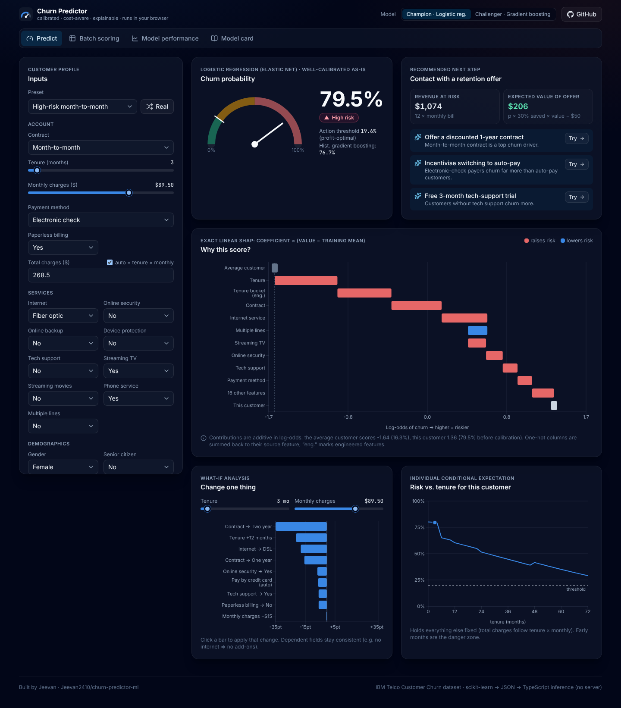
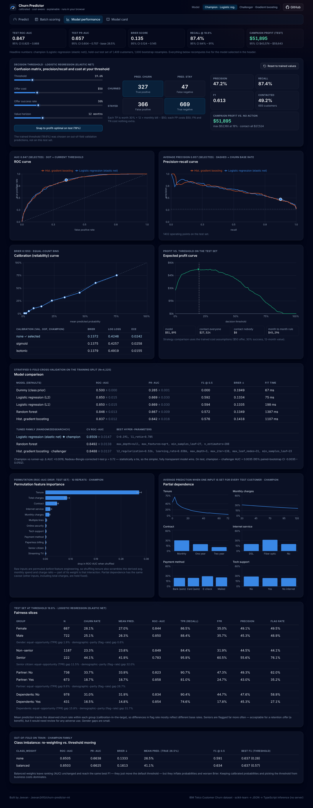
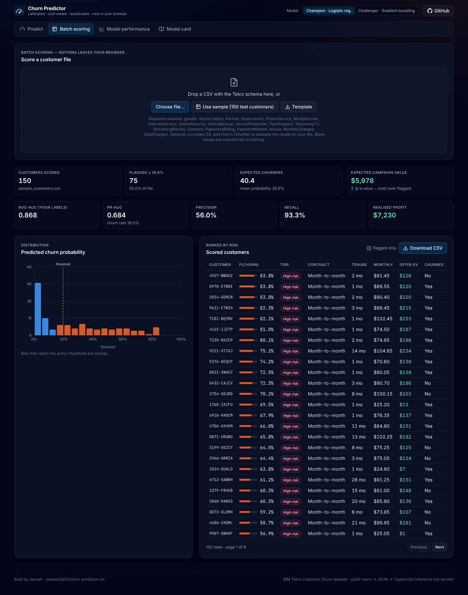

# Customer Churn Predictor: an ML pipeline with explainable predictions in the browser

**Live demo:** [churn-predictor-ml-jeevan.vercel.app](https://churn-predictor-ml-jeevan.vercel.app)

This project predicts which telecom customers are about to cancel, explains each prediction and works out whether a retention offer is worth sending. The model is a scikit-learn pipeline trained on the real **IBM Telco Customer Churn** dataset (7,043 customers). The pipeline avoids leakage, compares models with cross-validation, tunes hyper-parameters, checks calibration, sets the decision threshold from business costs, and reports bootstrap confidence intervals and fairness slices. The fitted model is **exported to JSON and scored in TypeScript in the browser**, with no server. A parity test shows the browser gives the same probabilities as scikit-learn to within **3e-16**.

**Tech:** Python 3.12 · scikit-learn 1.9 · pandas · NumPy · SciPy · pytest | React 19 · TypeScript (strict) · Vite 8 (Rolldown) · Tailwind CSS v4 · Recharts · oxlint · GitHub Actions



## Headline results (held-out test set, n = 1,409, 95% bootstrap CI over 1,000 resamples)

| Metric | Champion: logistic regression (elastic net) |
|---|---|
| **ROC-AUC** | **0.847** [0.825, 0.868] |
| PR-AUC (base rate 26.5%) | 0.657 [0.604, 0.707] |
| Brier score / ECE | 0.135 [0.124, 0.145] / 0.015 |
| Recall / precision @ profit-optimal threshold 0.196 | 87.4% [83.6, 90.6] / 47.2% [43.4, 50.9] |
| **Retention-campaign profit** vs. doing nothing | **$51.9k** [$43.6k, $59.6k] |
| … vs. contacting everyone / a "month-to-month" rule / perfect oracle | $27.5k / $45.3k / $79.3k |
| Challenger: tuned HistGradientBoosting (138 trees) | ROC-AUC 0.844 [0.822, 0.864]; paired Δ vs. champion +0.003 [−0.003, +0.010] |
| Export parity (JSON → TS vs. sklearn `predict_proba`, 200 rows) | max \|Δp\| = 2.2e-16 (champion), 3.3e-16 (challenger) |

5-fold stratified CV on the training split (ROC-AUC): dummy 0.500 · LR-L2 0.851 · LR-L1 0.850 · random forest 0.846 · HistGB 0.837. After a randomised search for each family, the scores were LR 0.851, RF 0.849 and HGB 0.849. The Nadeau–Bengio corrected t-test between the top two gives **p = 0.72**, so they are statistically tied. The transparent linear model becomes the champion and the boosted trees are shipped as the challenger. You can switch between them in the app.

## What the app does

| Page | What you can do |
|---|---|
| **Predict** | Fill in a customer form covering all 19 inputs, or pick a preset ("High-risk month-to-month", "Loyal two-year bundle"…) or a random real customer from the test set. You get a live probability gauge and risk tier, and a **SHAP waterfall** showing which features pushed the score up or down. A **recommended retention action** comes with its expected dollar value at the chosen threshold. There is also a **what-if** chart: click "Contract → Two year" to apply that change and see how far the risk drops. An ICE curve shows risk against tenure. |
| **Batch scoring** | Drop in a CSV with the Telco schema, or use the 150-customer sample. Rows are validated, scored and ranked locally, with a distribution chart and the expected campaign value. If the file has a `Churn` column, you also get AUC, precision, recall and realised profit. You can download the scored CSV. |
| **Model performance** | CV comparison and tuning tables. Adjust the threshold and cost assumptions to update the **confusion matrix, precision, recall, F1 and profit**. ROC and PR curves overlay both models and mark the current threshold point. Also shows the reliability curve, profit curve, permutation importance, partial dependence, **fairness slices** (gender, senior, partner, dependents) and the class-imbalance experiment. |
| **Model card** | Methodology, decisions, EDA insights, metrics with CIs, limitations and intended use. |

<p>
  
  
</p>

## Architecture

```mermaid
flowchart LR
  A[Telco CSV<br/>7,043 rows] --> B[Stratified split<br/>60 / 20 / 20]
  B -->|train| C[Pipeline: engineer → impute → scale / one-hot → classifier]
  C --> D[5-fold CV: dummy, LR-L1/L2, RF, HistGB<br/>RandomizedSearchCV per family]
  D --> E[Champion + challenger]
  B -->|validation| F[Calibration choice none / Platt / isotonic<br/>+ profit-optimal threshold, out-of-fold]
  E --> F
  F --> G[Test once: bootstrap CIs, fairness,<br/>permutation importance, PDP]
  F --> H[export.py → model.json<br/>imputers, scaler, vocabularies,<br/>coefficients / tree arrays, calibrator]
  H --> I[Python twin scorer<br/>parity ≤ 1e-9 asserted]
  H --> J[src/ml/*.ts<br/>features · model · TreeSHAP]
  J --> K[React app on Vercel<br/>no backend]
  I -. parity_fixture.json .-> J
```

- **`ml/`**: the training pipeline. `python ml/train.py` regenerates `public/model/*.json`, `public/sample_customers.csv`, `ml/reports/metrics.json` (experiment log), `ml/reports/figures/*.png` and [`ml/MODEL_CARD.md`](ml/MODEL_CARD.md). A full run takes about 4.5 minutes on a laptop, with all seeds fixed.
- **`src/ml/`**: the browser inference engine. It has no React imports. It covers feature engineering, imputation, scaling and one-hot encoding (`features.ts`), logistic, GBDT and forest scoring plus calibration (`model.ts`), explanations (`explain.ts`), metrics (`metrics.ts`) and a CSV parser (`csv.ts`).
- **`src/pages/`**: the four pages. They are lazy-loaded, so the model loads before the charts.

## ML engineering details

- **No leakage.** Only stateless row-wise cleaning happens before the split. All fitted state, such as medians, scaler means and one-hot vocabularies, lives inside the `Pipeline`, so cross-validation refits it on each training fold. Tests check that exported statistics equal the training-split statistics and differ from full-data ones. They also check that scoring corrupted test data never changes the fitted model.
- **Feature engineering** (`ml/churn/features.py`, mirrored line by line in `src/ml/features.ts`):
  - number of subscribed services
  - average historical monthly spend (`TotalCharges / tenure`)
  - charge ratio (current bill ÷ historical average, which flags recent price increases)
  - auto-pay flag
  - has-family flag
  - tenure bucket
- **Class imbalance**: tested `class_weight="balanced"` against threshold moving. Re-weighting left AUC unchanged (0.850 vs 0.850) and reached the same best F1. However, it inflated the mean prediction from 26.5% to 41% and worsened Brier from 0.133 to 0.161. **Decision:** keep calibrated probabilities and choose the threshold from costs.
- **Calibration**: compared no calibration, Platt scaling and isotonic regression using out-of-fold Brier on the validation split, with `CalibratedClassifierCV(FrozenEstimator(...))`. For this run the raw logistic probabilities were already best (test ECE 0.015). The exporter supports all three methods, and round-trip tests cover each one.
- **Business threshold**: each true positive is worth `offer_success × 12 × MonthlyCharges − offer_cost` and each false positive costs `−offer_cost`. The defaults are a $50 offer and a 30% save rate. Maximising this on validation predictions gives a threshold of **0.196**, well below 0.5 and below the F1-optimal 0.41. The Performance page lets you change these assumptions and see the effect.
- **Explanations**:
  - **Logistic champion**: exact linear SHAP, `coef × (z − training mean)`.
  - **Tree challenger**: exact **path-dependent TreeSHAP** (Lundberg et al. 2018, Algorithm 2), implemented from scratch in Python and TypeScript.
  - Pytest checks the TreeSHAP values against a brute-force Shapley computation and the `shap` library. Both languages check local accuracy (base + Σφ = raw score).
- **Fairness**: the test-set slices are calibrated within each group. At the action threshold the gender TPR gap is 1.9%. Seniors churn 44% vs 23% and are flagged 76% vs 44% of the time. That is acceptable for a beneficial retention offer, but the card flags it for review before any adverse use.

## Run it locally

```bash
# Web app (uses the committed model JSON, no Python needed)
npm ci
npm run dev        # http://localhost:5173
npm test           # TS ↔ sklearn parity (1e-9), TreeSHAP, metrics, CSV (Node ≥ 22.18)
npm run lint && npm run build

# Retrain everything from the CSV
pip install -r ml/requirements.txt
python ml/train.py          # add --fast for a ~1 min smoke run
pytest ml/tests             # leakage, export round-trip parity, TreeSHAP, metrics
```

CI (`.github/workflows/ci.yml`) has two jobs. A Node 22 job runs `npm ci`, lint, the parity tests and the build. A Python 3.12 job runs `pip install` and `pytest`.

## Exported model format (`public/model/model.json`)

```jsonc
{
  "preprocess": {
    "numeric":     { "features": [...], "impute": [...], "mean": [...], "scale": [...] },
    "categorical": { "features": [...], "impute": [...], "categories": [[...], ...] }
  },
  "feature_names": [...55], "feature_groups": [...55],          // one-hot → source feature
  "model": { "type": "logistic", "coef": [...], "intercept": -2.83 }
        // or { "type": "gbdt", "baseline", "trees": [{ feature, threshold, left, right,
        //      missing_left, value, cover }] }   // also "forest"
  "calibration": { "method": "none" | "isotonic" (x, y knots) | "sigmoid" (a, b) },
  "explanation": { "method": "linear" | "tree_shap", "background_mean": [...] },
  "threshold": 0.196, "business": { "offer_cost": 50, "offer_success": 0.3, "horizon_months": 12 }
}
```

## What this project demonstrates

- An end-to-end ML workflow that goes beyond fitting a model: model selection with significance testing, tuning, calibration, cost-sensitive decisions, uncertainty quantification, interpretability, fairness and a model card.
- MLOps-style care: reproducible seeds, generated reports, tests for leakage and export correctness, and CI for both languages.
- Deploying a model without a server: a self-describing JSON format, a reference scorer in Python, a TypeScript port validated to floating-point precision, and an exact TreeSHAP implementation in TypeScript.
- A product view of ML: the output is a ranked action list with dollar values, not only an AUC.

## Limitations

- Telco is a small sample dataset with no timestamps, so the split is random and drift over time is not tested.
- The cost model uses assumed values. A real deployment would measure the offer's save rate with an A/B test and would model *persuadability* (uplift modelling) rather than churn alone.
- Permutation importance and partial dependence permute **raw** inputs. Shuffling tenure therefore also scrambles the engineered spend ratios, which inflates tenure's importance (ROC-AUC drop of 0.35).

## Data

The data is the IBM *Telco Customer Churn* sample dataset ([source](https://github.com/IBM/telco-customer-churn-on-icp4d)), committed at `ml/data/Telco-Customer-Churn.csv`.

---

Built by **Jeevan** · [github.com/3T3RN4TU5](https://github.com/3T3RN4TU5)
