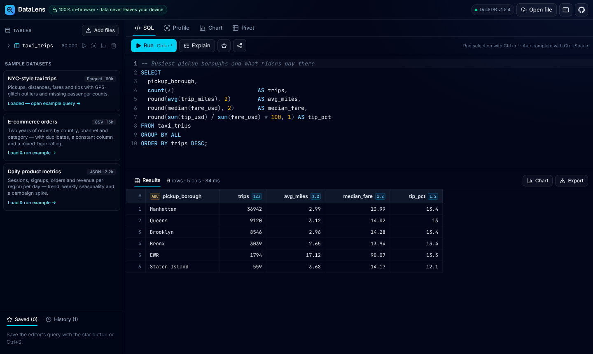
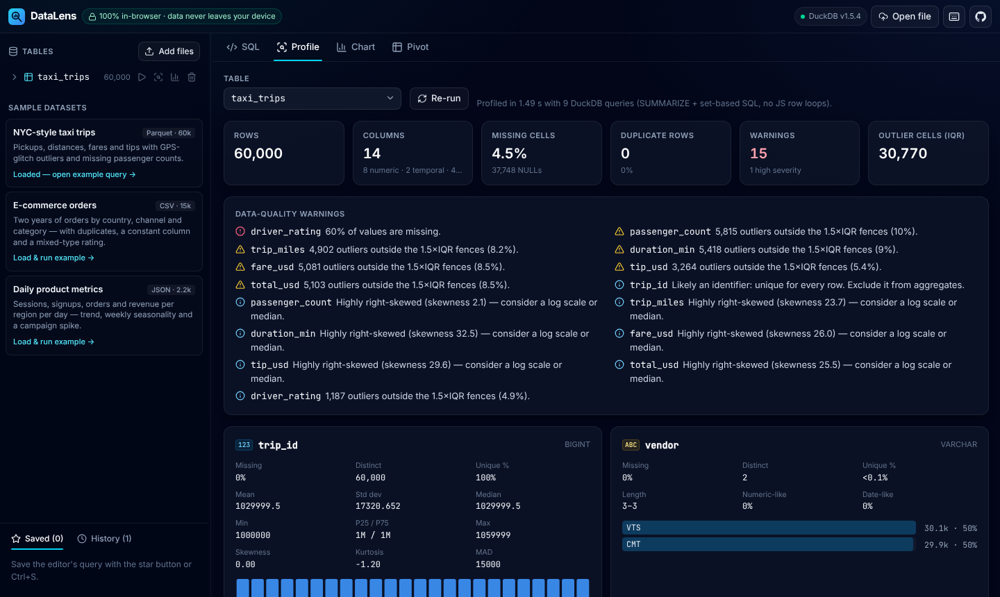
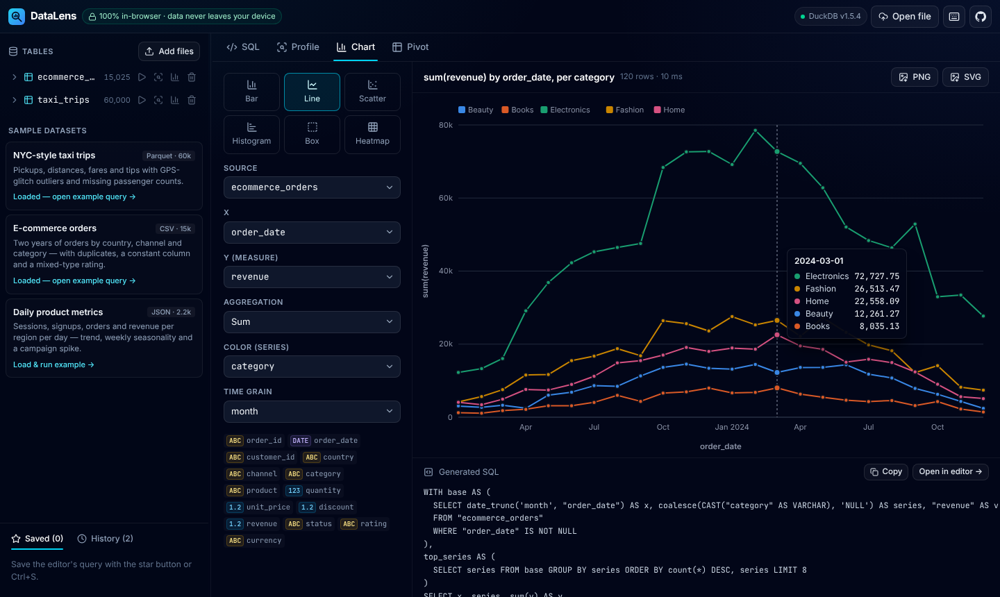
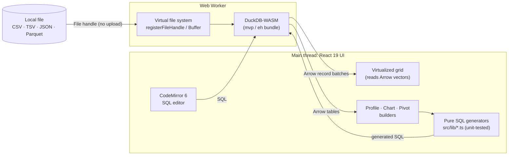

# DataLens: SQL analytics and automated EDA in the browser

**Live demo:** [datalens-eda-jeevan.vercel.app](https://datalens-eda-jeevan.vercel.app)

DataLens is a SQL workbench and exploratory-data-analysis tool that runs entirely in your browser. You can drop in a CSV, TSV, JSON or Parquet file, or open one of the bundled sample datasets, and query it with **DuckDB compiled to WebAssembly**. DataLens also profiles every column automatically: distributions, outliers, correlations, missing-value patterns and data-quality warnings. The chart and pivot builders show the SQL they generate.

There is no backend. Your file is registered with DuckDB inside a Web Worker in your tab and never leaves your device.







## Features

**Query**

- **DuckDB-WASM in a Web Worker.** It runs full analytical SQL: window functions, `PIVOT`, `QUALIFY`, `GROUP BY ALL`, `SUMMARIZE` and more. The UI thread stays responsive while a query runs.
- **CodeMirror 6 editor.** It has SQL highlighting and **schema-aware autocomplete** for tables and columns from the live catalog, plus about 120 DuckDB functions.
  - `Ctrl/⌘+Enter` runs the whole query, or only the selected text.
  - `Ctrl/⌘+Shift+E` shows the `EXPLAIN` plan.
  - `Esc` **cancels** a long-running query.
- **Streaming results.** Arrow record batches stream from the worker. The app reports execution time, row and column counts, and DuckDB errors in a readable panel. Results over 2 million rows are truncated with a notice so the browser tab doesn't run out of memory.
- **Virtualized results grid.**
  - Only the visible rows are in the DOM, and cells are read straight from Arrow vectors. **1,000,000 rows scroll at 60 fps.**
  - Each column header carries a type badge.
  - Click a header to sort. Numeric sorts use typed arrays.
  - Navigate cells with the keyboard, copy a cell with `Ctrl/⌘+C` or a double-click.
- **Export** in three formats:
  - **CSV** (RFC 4180 escaping) and **JSON**. Both are written in chunks, so exporting a million rows never builds one huge string.
  - **Parquet**, written with DuckDB `COPY … (FORMAT PARQUET)`.
- **Workspace.**
  - The editor text, query history (last 100) and saved queries persist in `localStorage`.
  - **Share links** carry the SQL in the URL hash. Bundled sample tables referenced by the query load automatically for the recipient.

**Automatic profiling** (every number is computed by DuckDB with set-based SQL, never JavaScript loops over rows)

- `SUMMARIZE` plus exact row count, **duplicate rows**, non-null and distinct counts per column, all in one scan.
- **Numeric columns**:
  - mean, standard deviation, min/max, p1/p5/p25/median/p75/p95/p99
  - **skewness, kurtosis and MAD**
  - histograms. Every column is binned in a single `UNPIVOT` pass.
- **Outlier detection with three methods**: Tukey fences (1.5×IQR), z-score (|z| > 3) and robust modified z-score (MAD). **Show rows** opens the SQL that lists the offending rows.
- **Correlation matrix.** Pearson r for every pair of numeric columns in one aggregate query, drawn as a diverging heatmap.
- **Missing-value pattern matrix.** It shows which columns are NULL together, and how often.
- **Data-quality warnings**, ranked by severity:
  - constant and all-NULL columns, heavy missingness
  - likely identifiers, high-cardinality text
  - **mixed types**, such as a `rating` column that is 97% numeric and 3% `"N/A"`
  - numbers or dates stored as text
  - stray whitespace, heavy skew, outlier rates
  - exact duplicate rows

**Chart builder**

- Six chart types: bar, line, scatter, histogram, box plot and heatmap. You pick X, Y, a color/series column, the aggregation and the time grain.
- Every chart is **one DuckDB query with a fixed output shape**. That SQL is shown under the chart, and **Open in editor** sends it to the SQL tab.
  - Histograms bin in SQL.
  - Box plots compute quartiles and Tukey whiskers in SQL.
  - Scatter uses a reproducible reservoir sample.
- Charts are hand-written SVG, so there is no charting library in the bundle. Scatter plots are drawn on a canvas so 20k points stay smooth.
- Charts have hover tooltips and a crosshair, and export as **PNG or SVG**.
- Series colors come from a colorblind-validated categorical palette applied in a fixed order. The correlation heatmap uses a diverging palette with a neutral midpoint.

**Pivot / group-by builder**

- Pick row dimensions, an optional pivot column and any number of measures (count, sum, avg, median, min, max, count distinct). Optional `ROLLUP` subtotals. The builder generates DuckDB `PIVOT … ON … USING …` or `GROUP BY` SQL.

**UX**

- A dark, responsive layout with **resizable panels**. The splitters work with the mouse, touch and keyboard (arrow keys).
- Drag and drop files anywhere on the page.
- Every view has empty, loading and error states. A `?` dialog lists the keyboard shortcuts.
- Accessibility: ARIA tabs, a grid role on the results, a native `<dialog>`, live status regions, visible focus rings and `prefers-reduced-motion` support.
- **Fast first paint.** DuckDB (35 MB of wasm), CodeMirror, Apache Arrow and the Profile, Chart and Pivot views are all lazy-loaded. The initial JavaScript is about 90 KB gzipped, and a progress bar tracks the engine download.

## Architecture



- **The engine** (`src/db/engine.ts`) selects the right DuckDB bundle for the browser. The worker and `.wasm` files are imported with Vite `?url`, so they ship with the site and no CDN is needed for the engine. The app uses the single-threaded mvp/eh builds, so no COOP/COEP headers are required. User queries and internal queries (profiling, charts, metadata) run on separate connections, so cancelling one never affects the other.
- **SQL generation is pure TypeScript** (`src/lib/chartSql.ts`, `pivotSql.ts`, `profileSql.ts`, `sql.ts`). It is fully unit-tested, quotes every identifier, and aliases columns by position so any column name is safe.
- **The Parquet and JSON readers** are DuckDB extensions, which DuckDB-WASM autoloads from the official extension repository. DataLens checks that the repository is reachable first. If it isn't (offline, or behind a strict proxy), DataLens turns autoloading off and falls back to extension-free paths: Parquet is decoded by [parquet-wasm](https://github.com/kylebarron/parquet-wasm) into Arrow IPC and inserted into DuckDB, and JSON goes through DuckDB-WASM's built-in JSON importer. Parquet export falls back the same way.

## Tech stack

React 19 · TypeScript (strict) · Vite 8 (Rolldown) · Tailwind CSS v4 · DuckDB-WASM · Apache Arrow · CodeMirror 6 · parquet-wasm (fallback only) · Lucide icons · oxlint · `node --test` · GitHub Actions · Vercel

## Run it locally

```bash
npm ci
npm run dev       # http://localhost:5173
npm test          # unit tests (Node ≥ 22.18 runs the .ts tests natively)
npm run lint      # oxlint
npm run build     # type-check + production build into dist/
npm run preview   # serve the production build
```

No environment variables are needed. The sample datasets in `public/samples/` are synthetic and deterministic. You can regenerate them with `npm run samples`, which needs Python with `duckdb` and `pandas`.

## Project structure

```
src/
├── db/            engine.ts (DuckDB-WASM wrapper), profile.ts (profiling pipeline),
│                  arrow.ts (Arrow helpers, sort), parquetFallback.ts
├── lib/           pure, tested logic: sql, types, format, csv, chartSql, pivotSql,
│                  profileSql (+ data-quality rules), scale, share, workspace
├── components/    QueryPanel, SqlEditor, ResultsGrid, ProfileView, ChartBuilder,
│                  PivotBuilder, Sidebar, Splitter, charts/
└── state/         useEngine (lazy boot, tables, loading)
tests/             node --test unit tests (72 tests)
scripts/           generate_samples.py
```

## Testing

`npm test` runs 72 unit tests over the pure logic:

- SQL generation for every chart type and for the pivot and group-by builders, including `ROLLUP`, `PIVOT` and de-duplicated aliases
- profiling SQL and the data-quality rules (duplicates, constant columns, IDs, mixed types, skew, outliers)
- DuckDB and Arrow type inference, and value formatting
- CSV escaping, checked by round-tripping through a parser; JSON export
- statement splitting and comment stripping, plus table naming
- share-link encoding, axis ticks and workspace persistence

The app was also exercised end to end in headless Chromium. That run loaded every sample, uploaded a CSV with quoted commas, quotes and NULLs, ran and cancelled queries, scrolled and sorted a 1,000,000-row result, exported CSV, Parquet, PNG and SVG, and opened a share link.

## What this project demonstrates

- **Analytics engineering in SQL.** The project uses window functions, `PIVOT`/`UNPIVOT`, `ROLLUP`, quantiles, `FILTER` clauses, reservoir sampling and single-pass multi-column aggregation, generated programmatically and safely.
- **Statistics for EDA.** It covers robust vs. classical outlier detection, skewness and kurtosis, correlation, and missingness analysis, plus practical data-quality heuristics.
- **Performance engineering.** WebAssembly runs in a worker, Arrow data stays columnar, the grid is virtualized, bundles are lazy-loaded and exports are chunked.
- **Product polish.** The app has keyboard-first UX, accessibility, empty and error states, shareable state and a CI pipeline.

## Limitations

- Data lives in memory for the session. Reloading the page clears loaded tables, but saved queries and history persist.
- The single-threaded WebAssembly build trades peak speed for zero-config hosting. Very large files, roughly 1 GB and up, are limited by the tab's memory.
- Excel files are not supported. Export them to CSV first.

## Author

Built by **Jeevan** · [github.com/3T3RN4TU5](https://github.com/3T3RN4TU5)
