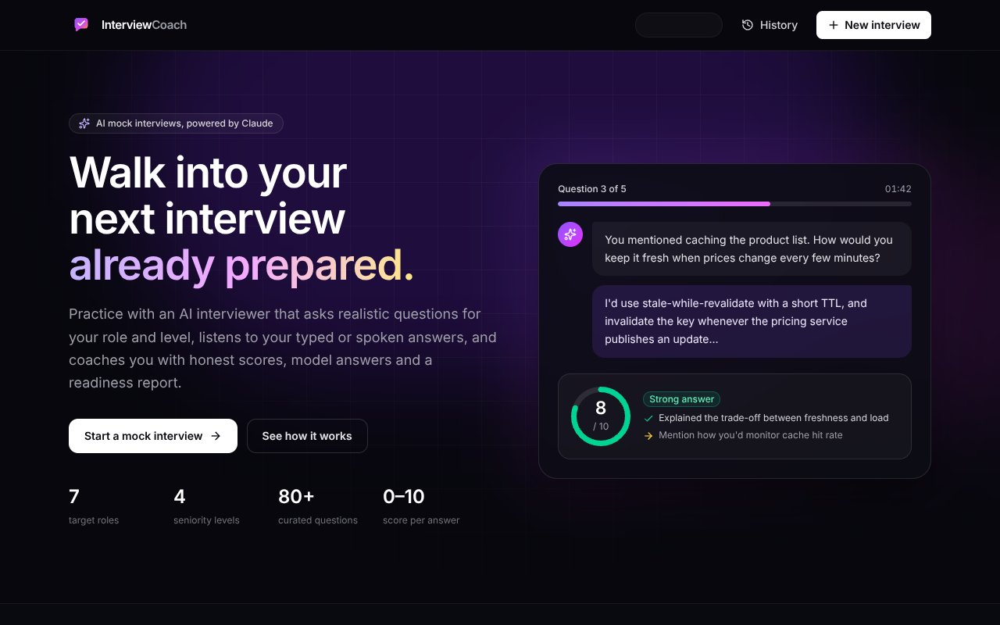
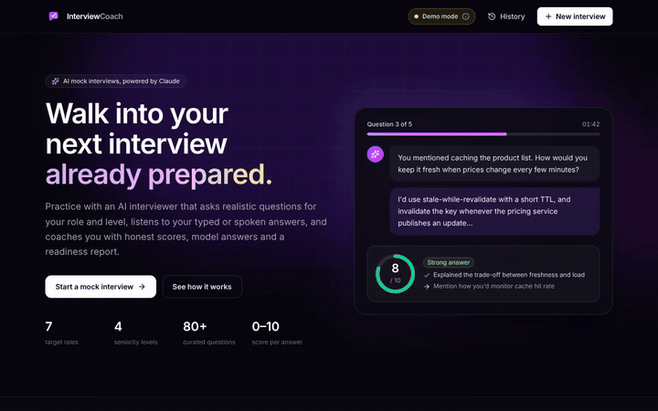

# 🎤 AI Interview Coach — Mock interviews with scored, actionable feedback

**Live demo:** [ai-interview-coach-jeevan.vercel.app](https://ai-interview-coach-jeevan.vercel.app)





Practice realistic job interviews with an AI interviewer powered by Claude. Pick a target role, seniority and interview style (optionally paste a job description), then answer one question at a time — typed or dictated by voice. Every answer gets a 0–10 score, specific strengths and improvements and a model answer, and the session ends with a readiness report you can download or print. Without an API key the app runs in a fully working **demo mode** with a curated question bank and a transparent heuristic scorer.

**Tech:** Next.js 16 (App Router, Route Handlers, Cache Components) · React 19 · TypeScript · Tailwind CSS v4 · Anthropic TypeScript SDK (Claude Opus 5.5) · Zod 4 · Web Speech API · Lucide icons

## Features

- **Interview setup** — 7 target roles (Frontend, Backend, Full-Stack, Data Analyst, DevOps / Cloud, Product Manager, HR / Behavioral), 4 levels (Intern / Fresher → Senior), Technical / Behavioral / Mixed, 3, 5 or 7 questions, and an optional job description (up to 6,000 characters) to tailor the questions. Your last setup is remembered.
- **Live interviewer** — one question at a time, **streamed token by token** from Claude. Follow-ups can build on what you said earlier, and the technical/behavioral mix follows the chosen interview type.
- **Answer composer** — large textarea with word and character counter (4,000 max), a per-question timer, `Ctrl/⌘ + Enter` to submit, Skip, and a **microphone button** for voice answers in Indian English (`en-IN`) using the Web Speech API. When the browser doesn't support it, the button is disabled with an explanatory tooltip.
- **Instant feedback** — an animated score ring (0–10), a verdict, competency tag, 1–3 strengths, 1–3 improvements and a collapsible model answer after every question.
- **Final report** — overall score out of 100, readiness verdict (Ready / Almost there / Not yet), summary, top strengths, focus areas, next steps, competency bars (Technical depth, Communication, Problem solving, Structure / STAR, Role knowledge) and a question-by-question breakdown.
- **Export** — download the report as Markdown or print it (a dedicated print stylesheet turns the dark UI into a clean light document).
- **History** — finished interviews are saved in `localStorage` (versioned keys, validated with Zod on read, kept in sync across tabs) with stats, reopen and delete. An unfinished interview — including a half-written answer — survives a refresh or closed tab and can be resumed or discarded, and starting a new interview asks before replacing it.
- **Live vs demo badge** — the header shows **Live AI (Claude)** or **Demo mode** from `GET /api/status`, with a popover explaining the difference.
- **Resilient UX** — loading skeletons, empty states, and friendly error cards with retry (and "Edit answer" when scoring fails). Accessible: semantic forms, keyboard-operable radio cards, focus management, native `<dialog>` modals, `aria-live` announcements and `prefers-reduced-motion` support.

## How it works

| Endpoint | Purpose |
| --- | --- |
| `GET /api/status` | `{ mode: "live" \| "demo", model }` — live only if `ANTHROPIC_API_KEY` is set |
| `POST /api/question` | Streams the next question as `text/plain`. Body: `{ config, history: [{ question, answer, score? }] }` |
| `POST /api/evaluate` | Scores one answer → `{ score, verdict, strengths, improvements, idealAnswer, competency }` |
| `POST /api/report` | Builds the final report → `{ overallScore, readiness, summary, topStrengths, focusAreas, nextSteps, competencies }` |

Every request body is validated with Zod (enums for role, level and type; answers ≤ 4,000 characters; job description ≤ 6,000; at most 10 history items; body ≤ 128 KB) and invalid input returns a `400` with a human-readable message. The client re-validates every response with the same schemas.

### Claude integration (live mode)

- **Model:** `claude-opus-5-5`. Thinking is left at its adaptive default (no sampling parameters), and only `text` blocks are read.
- **Effort:** `output_config.effort: "low"` for question generation (fast, conversational) and `"medium"` for scoring and the report.
- **Streaming:** `/api/question` uses `client.beta.messages.stream()` and forwards `text_delta` events into a `ReadableStream`. The handler waits for the first token before responding, so auth, rate-limit and refusal failures still become proper JSON errors with the right status code. If the browser disconnects, the stream's `cancel()` aborts the Anthropic request.
- **Structured output:** `/api/evaluate` and `/api/report` use `client.beta.messages.parse()` with `output_config.format: betaZodOutputFormat(schema)` (the beta-namespace twin of `zodOutputFormat`). The model-facing schemas are deliberately loose: the SDK's schema transform passes enums through only as descriptions, so competency names are plain strings matched leniently on the server instead of failing the request. The server then clamps scores, trims lists, derives the verdict and readiness from the score, and handles a `null` `parsed_output`.
- **Refusal fallbacks:** every request opts into server-side fallbacks with `betas: ["server-side-fallback-2026-07-01"]` and `fallbacks: "default"`. Both are typed in the installed SDK (`@anthropic-ai/sdk` 0.132), which is why the beta `stream`/`parse` methods are used. `stop_reason === "refusal"` is still checked before reading content and becomes a friendly `422`.
- **Errors:** SDK errors are mapped most-specific first — `AuthenticationError` → 503, `RateLimitError` → 429 (with `Retry-After`), `BadRequestError` → 400, other `APIError` → 503, malformed output → 502 — and shown in the UI with a retry button.
- **Prompts** live in [`src/lib/server/prompts.ts`](src/lib/server/prompts.ts): a stable interviewer system prompt (one question per turn, pitched at the role and level, tailored to the job description, never repeating a question) and an evaluator prompt with a calibrated rubric (9–10 exceptional, 7–8 strong, 5–6 adequate, 3–4 weak, 0–2 missing/off-topic). The per-turn instruction ("ask question 3 of 5, behavioral") is sent as a mid-conversation `system` message, so it never mixes with the candidate's untrusted answer text.
- The Anthropic client is created lazily, only on the server, and the key never reaches the browser.

### Demo mode (no API key)

The whole app works end to end without a key:

- **Question bank** of 84 curated questions: 9 technical (three difficulty tiers) and 2 behavioral questions for each role, a shared pool of 9 behavioral questions and 9 HR questions. Questions are picked to match the level (and nudged towards the job description's keywords), never repeat, and stream word by word with a short delay so the UI behaves exactly like the live model.
- **Transparent heuristic evaluator** returning the same schema: answer length, structure and signposting, reasoning and trade-off language, concrete examples and numbers, STAR elements for behavioral answers, and coverage of each question's expected concepts. Keyword coverage sets a ceiling on the score, and scores are capped at 9 because a heuristic can't verify correctness.
- **Heuristic report** that aggregates the per-question scores with delivery signals per competency, then adds role-specific next steps.

### Rate limiting

`/api/question`, `/api/evaluate` and `/api/report` share a best-effort **per-IP sliding window of 40 requests per 10 minutes** (a 5-question interview uses about 11 requests) and return `429` with a `Retry-After` header. The client IP comes from `x-forwarded-for`, which Vercel sets at its edge. The counters live **in memory, per serverless instance**: they reset on cold starts and aren't shared across instances or regions. That's enough to stop casual abuse of the API key without adding infrastructure. For a hard global limit, move the counters to a shared store such as Upstash Redis or Vercel KV.

## Getting started

```bash
npm install
npm run dev      # http://localhost:3000 (demo mode)
npm run build    # production build
npm run lint
```

### Environment variables

| Variable | Required | Description |
| --- | --- | --- |
| `ANTHROPIC_API_KEY` | No | Enables live AI with Claude. Without it the app runs in demo mode. |

Locally, copy `.env.example` to `.env.local` and add your key. **On Vercel:** open *Project Settings → Environment Variables*, add `ANTHROPIC_API_KEY` for the Production (and optionally Preview) environment, then **redeploy** — the header badge switches from *Demo mode* to *Live AI (Claude)*. The AI routes set `maxDuration = 60` seconds to leave room for longer Claude responses.

## Structure

```
src/
├── app/
│   ├── page.tsx                  # Landing: hero, how it works, setup card
│   ├── interview/page.tsx        # Interview screen
│   ├── report/page.tsx           # Report (?id=…), wrapped in <Suspense>
│   ├── history/page.tsx          # Past interviews
│   ├── api/
│   │   ├── status/route.ts       # GET  live vs demo
│   │   ├── question/route.ts     # POST streamed next question
│   │   ├── evaluate/route.ts     # POST structured answer feedback
│   │   └── report/route.ts       # POST structured final report
│   ├── layout.tsx, globals.css, icon.svg, not-found.tsx
├── components/
│   ├── layout/                   # Header, footer, status provider + badge
│   ├── setup/                    # Setup form, resume banner
│   ├── interview/                # State machine, question card, composer, timer, feedback, progress
│   ├── report/                   # Report view, competency bars, question breakdown
│   ├── history/                  # History list, stats, delete
│   └── ui/                       # Score ring, badges, dialog, error notice, icons
├── hooks/useSpeechRecognition.ts # Web Speech API (en-IN) with feature detection
└── lib/
    ├── constants.ts, schemas.ts  # Shared options and Zod schemas (client + server)
    ├── interview.ts              # Question mix, verdict/readiness rules, helpers
    ├── api.ts                    # Typed fetch + streaming client
    ├── storage.ts                # Versioned localStorage stores (useSyncExternalStore)
    ├── markdown.ts               # Report → Markdown export
    └── server/
        ├── anthropic.ts          # Lazy client, model, error mapping
        ├── live.ts               # Claude streaming + structured outputs
        ├── prompts.ts            # System prompts and message builders
        ├── normalize.ts          # Clamp and normalize AI output
        ├── rate-limit.ts         # Per-IP sliding window
        ├── http.ts               # Body parsing, JSON errors
        └── demo/                 # Question bank + heuristic evaluator/report
```
