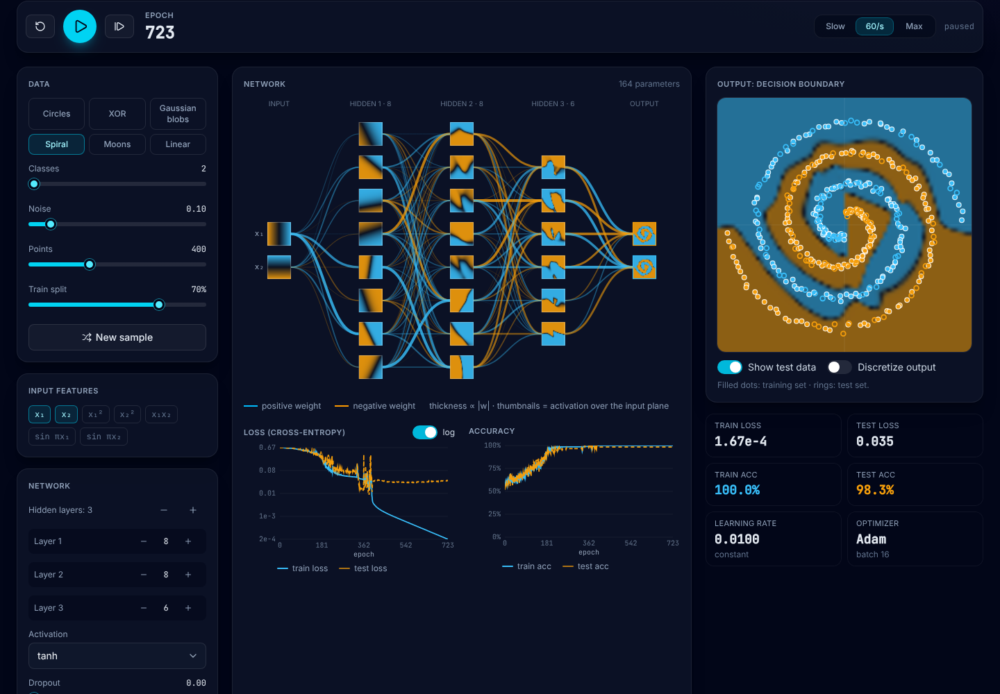
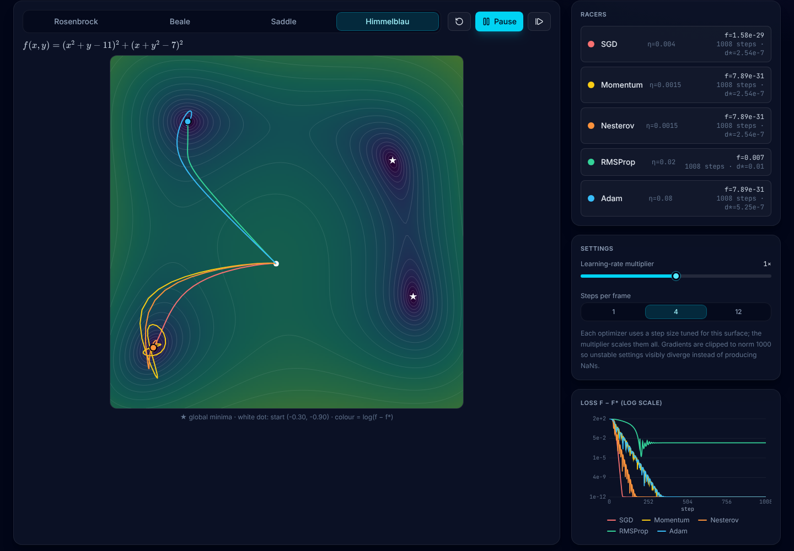
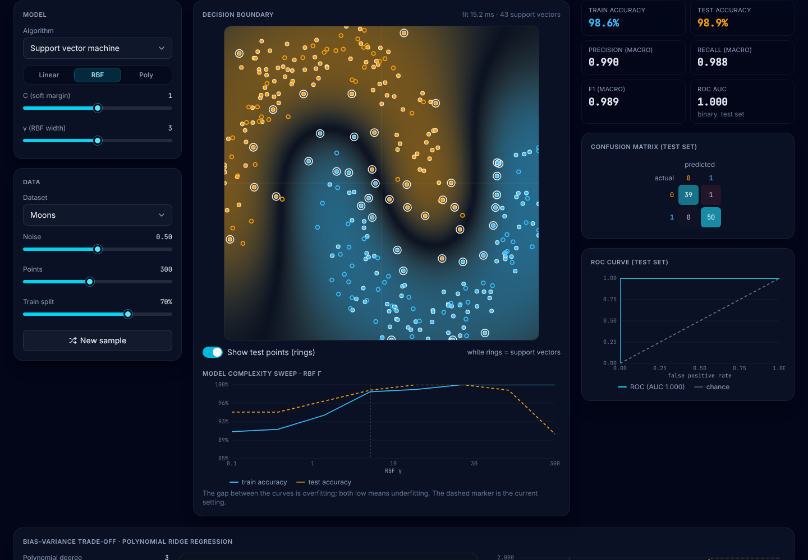
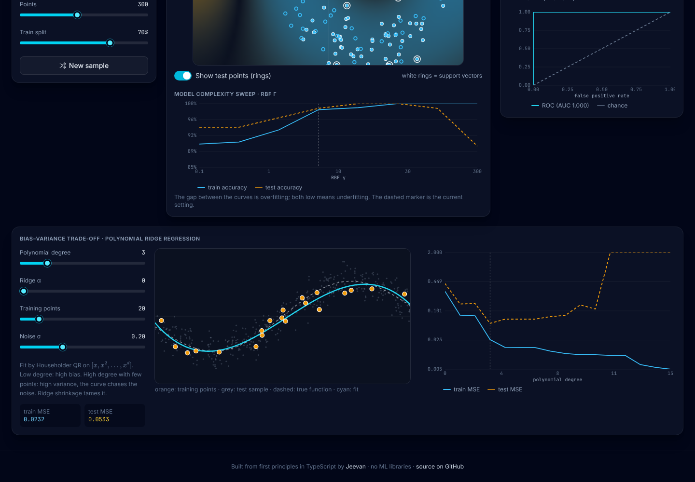
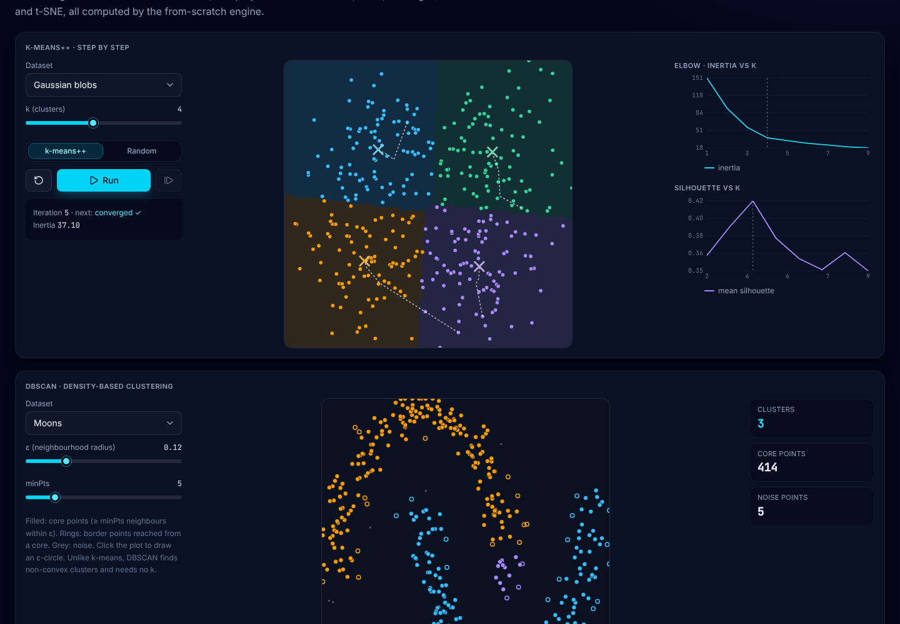
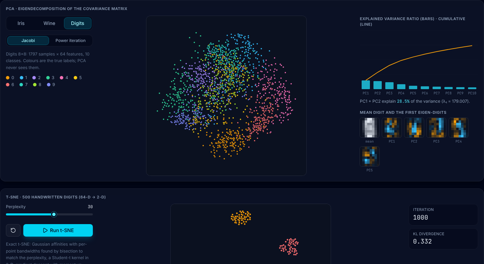
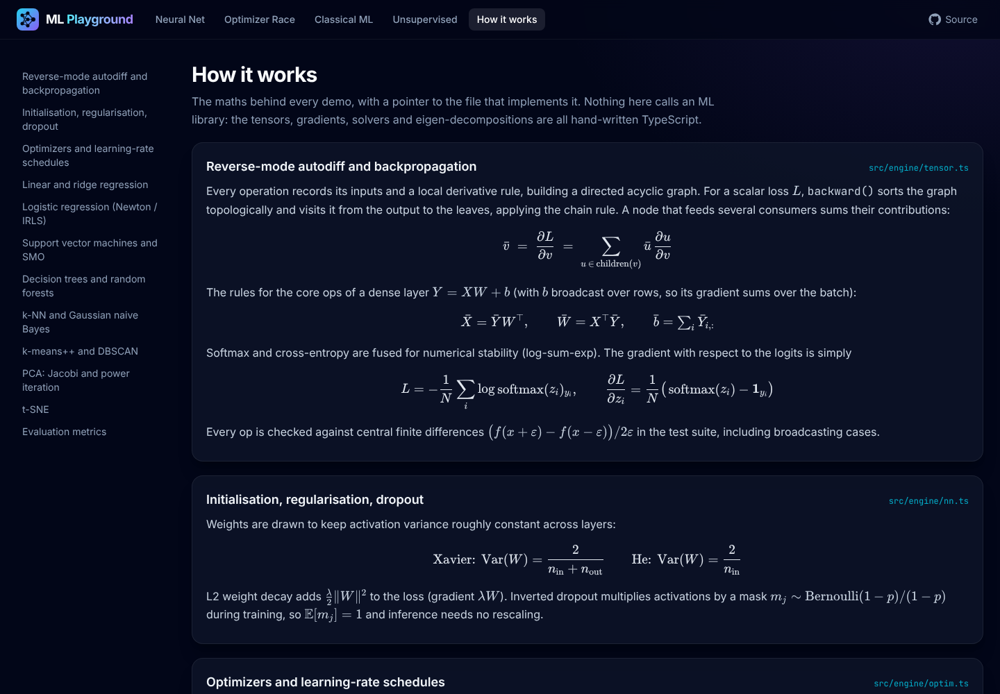
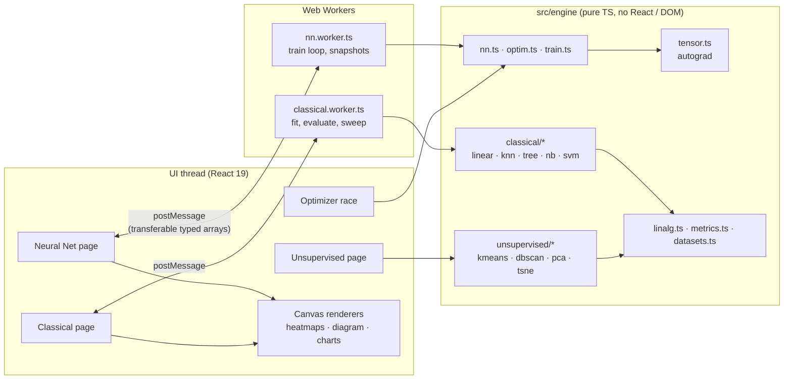

# ML Playground: machine learning from first principles, in the browser

**Live demo:** [ml-playground-jeevan.vercel.app](https://ml-playground-jeevan.vercel.app)

[](https://github.com/3T3RN4TU5/ml-playground/actions/workflows/ci.yml)

An interactive machine-learning lab where **every algorithm is written from scratch in TypeScript**, with no TensorFlow.js, no ONNX and no math library. It includes a reverse-mode autodiff engine with gradient-checked ops, a neural-network playground that trains live in a Web Worker, an optimizer race on classic loss surfaces, six classical classifiers, and unsupervised learning (k-means++, DBSCAN, PCA, t-SNE) on real datasets. Every result is checked by **89 automated tests**, including cross-checks against scikit-learn.

**Tech:** React 19 · TypeScript (strict) · Vite 8 (Rolldown) · Tailwind CSS v4 · Web Workers · Canvas 2D · KaTeX. Runtime dependencies: React, KaTeX and an icon set. The ML is all in `src/engine/`.



## Features

### 1. Neural network playground
- Six 2-D datasets (spiral with 2 to 5 arms, circles, XOR, Gaussian blobs, moons, linear) with noise, size and train/test-split controls
- Seven input features (x₁, x₂, x₁², x₂², x₁x₂, sin πx₁, sin πx₂), up to 6 hidden layers of up to 12 neurons, and tanh / ReLU / leaky ReLU / sigmoid / linear activations
- **Optimizers:** SGD, Momentum, Nesterov, RMSProp, Adam, AdamW. Learning rate, batch size, L2 weight decay, dropout, and step or cosine (warm-restart) LR schedules
- Training runs in a **Web Worker** with play, pause, single-epoch step, reset, and three speeds. The worker packs epochs into a ~12 ms budget per tick and posts snapshots at most every 40 ms as transferable typed arrays, so the UI thread only draws
- Decision-boundary heatmap with train points (filled) and test points (rings), plus a discretize toggle and **train vs test loss and accuracy curves**
- **Network diagram on canvas:** edge colour shows the weight sign and thickness its magnitude. Every node shows a thumbnail of its activation over the input plane. **Hover a neuron** to show its response in the large plot
- Multiclass softmax output, so blobs and spirals can have 3 to 5 classes

### 2. Optimizer race

- SGD, Momentum, Nesterov, RMSProp and Adam start from the same point on **Rosenbrock, Beale, a saddle and Himmelblau**. Gradients come from the autograd engine, not from hand-written derivatives
- Filled log-scale contour plot (marching squares) with the minima marked. **Click to move the start point**
- Animated trajectories, a learning-rate multiplier, steps-per-frame control, divergence detection and a log-scale loss-per-step chart

### 3. Classical ML

- **Logistic regression** (Newton/IRLS, polynomial features, L2), **k-NN** (k-d tree, optional distance weighting), **decision tree** (CART, Gini or entropy, depth and min-split limits), **random forest** (bootstrap with √d features per split), **Gaussian naive Bayes**, and an **SVM** (SMO with LIBSVM-style second-order working-set selection; linear, RBF and polynomial kernels; one-vs-rest for multiclass, with support vectors highlighted)
- Datasets: the 2-D generators, plus **Iris** and **Wine** projected to 2-D with the app's own PCA
- Metrics on a held-out test set: accuracy, macro precision / recall / F1, a confusion matrix, and a **ROC curve with AUC** for binary problems
- A **model complexity sweep** of train vs test accuracy over the main hyper-parameter (degree, k, depth, γ or C), which shows overfitting directly
- A **bias–variance demo**: polynomial ridge regression on 1-D data, with the fitted curve and train vs test MSE plotted against degree



### 4. Unsupervised learning

- **k-means++, one step at a time**: assign, then update, with Voronoi regions and centroid trails. Compare k-means++ with random initialisation. Includes an **elbow curve** (inertia) and silhouette scores for k = 1 to 9
- **DBSCAN** with ε and minPts sliders. Core, border and noise points are drawn differently, and you can click to draw an ε-ball
- **PCA** on Iris, Wine and the **8×8 digits** dataset, using either the Jacobi or the power-iteration solver, with optional standardisation, an explained-variance chart, loading arrows, and the mean digit with the top **eigen-digits**
- **Exact t-SNE** on 500 digits, animated in the browser with a perplexity slider and a live KL divergence



### 5. How it works
Concise KaTeX-rendered maths for backprop, initialisation, every optimizer, least squares (Cholesky and QR), IRLS, the SVM dual and SMO, CART, naive Bayes, k-means++, DBSCAN, PCA, t-SNE and the evaluation metrics. Each section links to the file that implements it.



## Architecture



- **`src/engine/`** has no React or DOM imports, so the same code runs in workers, on the main thread and under Node in the tests.
- **Tensor**: a row-major `Float64Array` plus a shape. Ops include broadcasting `add/sub/mul/div`, `matmul`, `transpose`, `reshape`, `exp/log/sqrt/abs/sin/tanh/sigmoid/relu/leakyRelu/pow`, `sum/mean` (all or per axis), `softmax/logSoftmax`, and fused **softmax cross-entropy**, **BCE-with-logits** and **MSE** losses. `backward()` does an iterative topological sort, then runs the reverse sweep. Gradients on broadcast inputs are summed automatically, and the graph is released afterwards. `noGrad()` is used for inference.
- **Linear algebra** (`linalg.ts`): Cholesky, Householder-QR least squares, cyclic Jacobi eigen-decomposition, and power iteration with deflation.
- **Performance:** typed arrays throughout. Heatmaps go to `ImageData` at grid resolution and are upscaled with smoothing. The network diagram is one canvas. Only the latest classical-fit request is served, and older ones are dropped. Pages and the 260 KB digits dataset are lazy-loaded.

```
src/
├── engine/                 # the ML library (≈3.5k lines, pure TypeScript)
│   ├── tensor.ts           # autograd
│   ├── nn.ts · optim.ts · train.ts
│   ├── linalg.ts · metrics.ts · datasets.ts · surfaces.ts
│   ├── classical/          # linear/logistic, knn (k-d tree), tree/forest, naive Bayes, SVM (SMO)
│   └── unsupervised/       # k-means++, DBSCAN, PCA, t-SNE
├── workers/                # nn.worker.ts, classical.worker.ts (+ message protocols)
├── pages/                  # lazy-loaded pages
├── components/             # charts (canvas/SVG), controls, KaTeX
└── data/                   # Iris, Wine, Digits (exported from scikit-learn)
tests/                      # node:test suites + scikit-learn fixtures
scripts/make_fixtures.py    # regenerates datasets and fixtures
```

## Test suite

`npm test` runs **89 tests** with Node's built-in runner (`node --test`, TypeScript run directly with type stripping) in about 3 seconds:

| Area | What is verified |
| --- | --- |
| **Autograd** | Every op's gradient matches central finite differences (rel. err < 1e-6). This covers six broadcasting patterns for `add/sub/mul/div`, all unary ops, `matmul` chains, axis reductions, `softmax/logSoftmax`, all three losses, a full MLP's parameters, gradient accumulation through reused tensors, and numerical stability for ±1000 logits |
| **Optimizers** | All six converge to the minimiser of an ill-conditioned convex quadratic. Momentum beats SGD by 10×. Coupled L2 skips biases. AdamW decays weights independently of the gradient. Step and cosine schedules return exact values. Adam solves Rosenbrock. Surface autograd matches the analytic gradient |
| **Neural nets** | An MLP solves XOR at 100% (and noisy XOR above 99% on held-out data) and fits the spiral above 97%. Xavier/He initialisation variances and inverted-dropout expectation are checked |
| **Linear models** | Cholesky and QR normal equations and ridge match **scikit-learn** `LinearRegression`/`Ridge` to 1e-8. Gradient descent through autograd converges to the closed form. Newton/IRLS logistic regression matches sklearn to 1e-6, and GD reaches the same optimum. The bias–variance curve has the expected shape |
| **Other classifiers** | The k-d tree returns exactly the brute-force neighbours (300 queries). An unlimited-depth tree fits training data perfectly (Gini and entropy). The forest beats a single tree on noisy held-out data. Gaussian NB matches sklearn means, variances and predictions on Iris. A linear SVM separates linearly separable data with functional margin ≥ 1 and few support vectors. An RBF SVM solves circles, and one-vs-rest handles 3 classes |
| **Unsupervised** | Jacobi and power iteration recover the known eigenvalues of a crafted QΛQᵀ matrix. PCA matches sklearn on Iris (variances and components). k-means++ recovers well-separated blobs (pure clusters, centres within 0.2). Inertia is monotone in k. DBSCAN finds both moons and flags outliers. t-SNE lowers KL and separates clusters. ROC AUC, confusion matrix and precision/recall/F1 are correct |

The scikit-learn reference values live in `tests/fixtures/sklearn.json`. `npm run fixtures` regenerates them, and the bundled datasets, with Python (numpy and scikit-learn). They are committed, so neither the app nor the tests need Python.

## Getting started

```bash
npm install
npm run dev       # http://localhost:5173
npm test          # 89 engine tests (Node ≥ 22.18)
npm run lint      # oxlint
npm run build     # type-check + production build
```

There are no environment variables or backend. CI (GitHub Actions) runs lint, test and build on Node 22. The production build is a static site deployed on Vercel.

## What this project demonstrates

- **ML fundamentals from first principles**: backpropagation as reverse-mode autodiff, optimizer dynamics, regularisation, the bias–variance trade-off, kernel methods and convex duality, tree induction, ensembling, clustering and dimensionality reduction
- **Numerical computing**: stable softmax and log-sum-exp, QR rather than normal equations, Jacobi rotations, perplexity calibration by bisection, and gradient clipping
- **Verification discipline**: gradient checks, convergence tests, invariants, and cross-validation against scikit-learn
- **Front-end performance engineering**: off-main-thread training, transferable buffers, canvas rendering at typed-array speed, and code-split lazy pages

## Author

Built by **Jeevan** ([@3T3RN4TU5](https://github.com/3T3RN4TU5)). Licensed under MIT.
