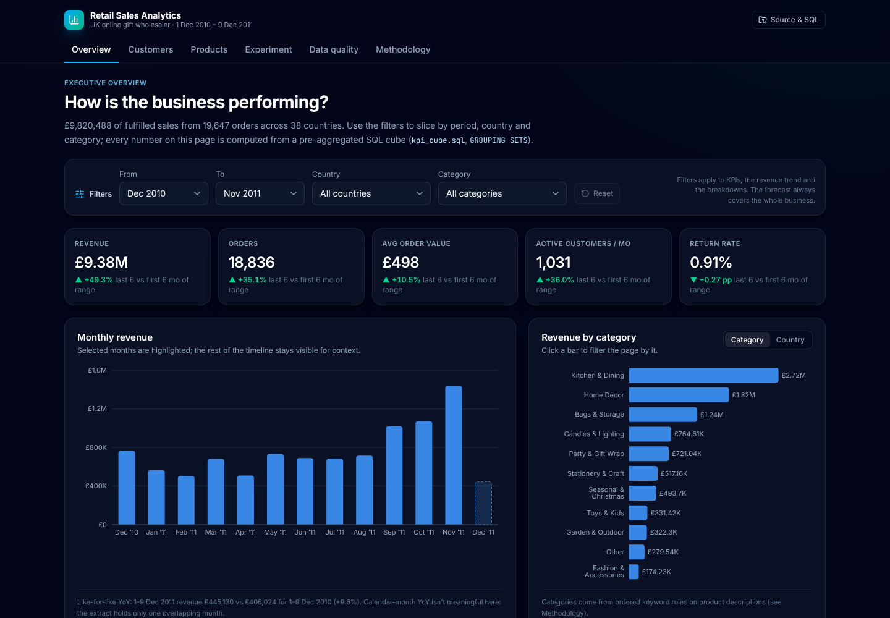
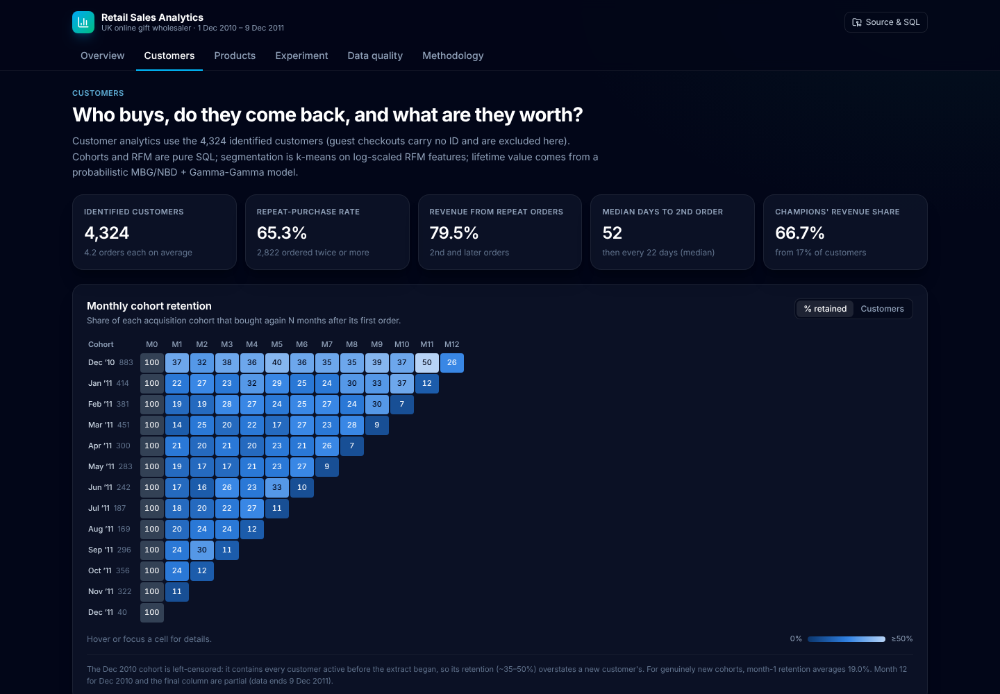
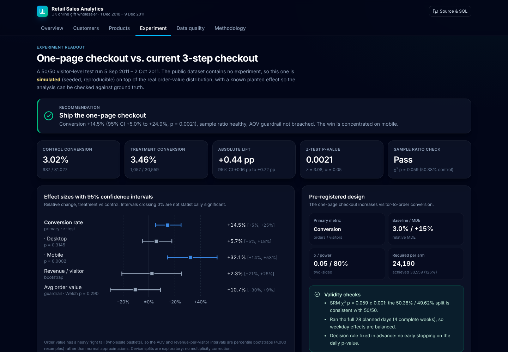
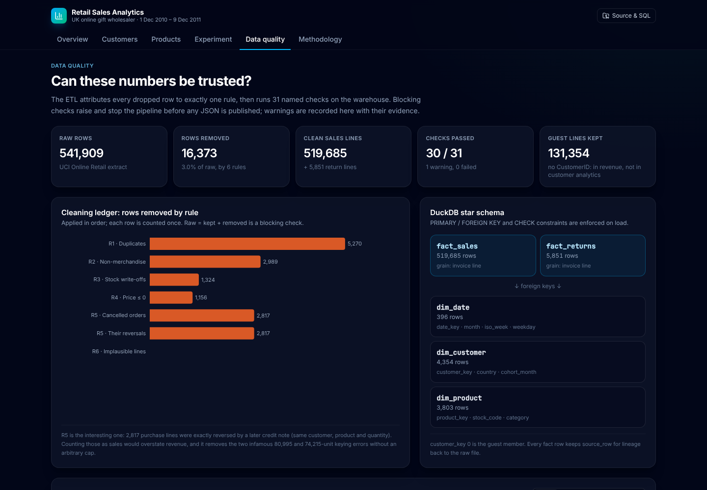
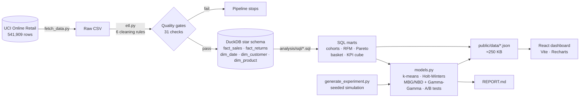

# Retail Sales Analytics: end-to-end case study

**Live demo:** [retail-sales-analytics-jeevan.vercel.app](https://retail-sales-analytics-jeevan.vercel.app) · **Stakeholder memo:** [`analysis/REPORT.md`](analysis/REPORT.md)

An analyst's full workflow on **541,909 real transactions** from a UK online gift wholesaler (UCI *Online Retail*, Dec 2010 – Dec 2011).

- **Pipeline:** raw CSV → a tested cleaning pipeline with data-quality gates → a **DuckDB star schema** → SQL marts written with window functions, CTEs and `GROUPING SETS`.
- **Models:** customer segmentation, demand forecasting, A/B-test analysis and probabilistic customer lifetime value.
- **Dashboard:** an interactive React app with filters and CSV export.
- **Memo:** findings and recommendations written for commercial leadership.

Every number on the dashboard comes from one reproducible command.



## Key findings

| | Finding |
|---|---|
| **Growth** | Jun–Nov revenue **£5.61M, +49%** vs Dec–May. Sep–Nov = **38%** of annual revenue; early December **+9.6% YoY** like-for-like. |
| **Customers** | **17% of customers ("Champions") drive 67% of revenue.** 65% reorder and repeat orders are 79% of revenue, but only **19%** of a new cohort returns the next month. |
| **Products** | **22% of SKUs → 80% of revenue**; 1,988 C-class SKUs (53% of the range) → 5%. Design variants sell as sets (lift up to **76×**). |
| **Experiment** | One-page checkout lifts conversion **+14.5%** (95% CI +5.0% to +24.9%, p = 0.002), driven by mobile (+32%). Recommendation: **ship**. *(Simulated; see Caveats.)* |
| **Forecast** | Holt-Winters beats seasonal-naive (29.6% vs 37.9% weekly MAPE), but every model misses the Q4 ramp (−29% bias). Plan December to the YoY anchor. |
| **CLV** | £8.1M expected 12-month revenue from today's customers; the top decile holds 49%. |
| **Data quality** | 16,373 rows (3.0%) removed by 6 documented rules. All 30 blocking checks pass; 1 documented warning. |

## Screenshots

| Customers: cohorts, segments, CLV | Experiment readout | Data quality |
|---|---|---|
|  |  |  |

## Architecture



## What it demonstrates

**SQL**
- A star-schema design with enforced primary keys, foreign keys and `CHECK` constraints.
- Window functions: `LAG`, `NTILE`, `FIRST_VALUE`, running sums.
- CTEs, `GROUPING SETS` and anti-joins for integrity checks.
- Basket analysis as a self-join with Apriori pruning.

**Data cleaning and data quality**
- Every dropped row is attributed to exactly one rule, and raw = kept + removed is reconciled.
- Cancellations are matched one-to-one to the purchase they reverse, rather than capping outliers arbitrarily.
- 31 named checks fail loudly before anything is published.

**Statistics**
- A/B testing: two-proportion z-test, delta-method CI for relative lift, Welch t-test and bootstrap CIs for heavy-tailed revenue.
- Experiment design: sample-ratio-mismatch check, power and MDE, and a peeking demonstration.

**Modelling**
- k-means on log-scaled RFM features, with k chosen by silhouette score.
- Holt-Winters forecasting with simulated prediction intervals and an honest back-test against baselines.
- An MBG/NBD + Gamma-Gamma CLV model implemented from the likelihoods in SciPy and validated on a holdout.

**Communication**
- An executive memo with owners and KPIs.
- Caveats stated plainly, e.g. "churn isn't identifiable from 12 months of data" and "plan to the YoY anchor, not the model".

**Engineering**
- Tested Python (pytest, 35 tests) and tested TypeScript (`node --test`).
- Strict TypeScript, oxlint, code-split bundles, accessible UI (WAI-ARIA tabs, table-based heatmaps, labelled status badges), and CI on every push.

## Tech stack

| Layer | Tools |
|---|---|
| Analysis | Python 3.12, pandas, NumPy, SciPy, scikit-learn, statsmodels |
| Warehouse | DuckDB (embedded, columnar), SQL |
| Dashboard | React 19, TypeScript 6 (strict), Vite 8 (Rolldown), Tailwind CSS v4, Recharts 3, lucide-react |
| Quality | pytest, `node --test`, oxlint, GitHub Actions |
| Hosting | Vercel (static) |

## Run it locally

```bash
# 1. Dashboard: uses the committed JSON in public/data, no Python needed
npm ci
npm run dev        # http://localhost:5173
npm run build      # type-check + production build
npm run lint       # oxlint
npm test           # verifies the data files + TS helpers

# 2. Analysis pipeline: rebuilds everything from the raw data
python -m venv .venv && source .venv/bin/activate
pip install -r analysis/requirements.txt
python analysis/run_pipeline.py   # fetch → ETL → checks → SQL → models → public/data/*.json  (~1 min)
pytest analysis/tests -q
```

### Getting the raw data

The raw CSV (45 MB) and the DuckDB warehouse (45 MB) are **not committed**: `analysis/data/` is git-ignored. `run_pipeline.py` downloads the data automatically on first run via `analysis/fetch_data.py`, which tries two sources in order:

1. **UCI Machine Learning Repository** ([dataset 352](https://archive.ics.uci.edu/dataset/352/online+retail)), in its original `.xlsx` form.
2. A CSV export of the same table published in the [Databricks *Spark: The Definitive Guide*](https://github.com/databricks/Spark-The-Definitive-Guide) repository, used as a fallback. This is what the committed results were built from (SHA-256 recorded in `analysis/config.py`).

Either way the table has the same 541,909 rows, and the first data-quality check verifies that count.

## Project structure

```
retail-sales-analytics/
├── analysis/
│   ├── fetch_data.py           # download raw data (UCI → mirror fallback)
│   ├── etl.py                  # cleaning rules, star schema load, quality checks
│   ├── quality.py              # check framework that fails loudly
│   ├── categories.py           # rule-based product categories
│   ├── metrics.py              # pure stats: z/Welch/bootstrap/SRM/power, MBG/NBD, Gamma-Gamma, MAPE
│   ├── models.py               # segmentation, forecasting, A/B readout, CLV
│   ├── generate_experiment.py  # seeded A/B simulation on real order values
│   ├── run_pipeline.py         # entry point → public/data/*.json
│   ├── sql/                    # schema.sql + 15 analytical queries
│   ├── tests/                  # pytest: ETL rules, SQL on a toy warehouse, metrics, models
│   ├── requirements.txt
│   └── REPORT.md               # stakeholder memo
├── public/data/                # committed JSON aggregates (≈250 KB)
├── src/
│   ├── lib/                    # data loading, cube aggregation, formatting, CSV, routing
│   ├── components/             # cards, KPI tiles, sortable tables, heatmap, filters
│   └── pages/                  # Overview, Customers, Products, Experiment, Quality, Methodology
├── scripts/verify-data.ts      # node --test checks on the published data
├── docs/                       # screenshots
└── .github/workflows/ci.yml
```

## Caveats

- **The A/B test is simulated.** The public dataset has no experiment, so `generate_experiment.py` simulates a seeded, reproducible one: visitors are synthetic, while order values are resampled from the real cleaned orders. It plants a known effect (+28% mobile, +8% desktop, no AOV effect), so the analysis can be checked against ground truth. The dashboard labels it as simulated everywhere. All other analysis uses the real transactions.
- **One year of history.** There is no annual seasonality to learn and churn is not identifiable, so the forecast and CLV carry those limitations explicitly.
- **No cost data.** CLV and all value metrics are revenue, not margin.
- **Heuristic categories.** Products are categorised by keyword rules; "Other" holds 3% of revenue.

## Data licence and author

Data: Daqing Chen, Sai Liang Sain & Kun Guo (2012), *Online Retail*, UCI Machine Learning Repository, [CC BY 4.0](https://creativecommons.org/licenses/by/4.0/).

Built by **Jeevan** · [github.com/Jeevan2410](https://github.com/Jeevan2410)
